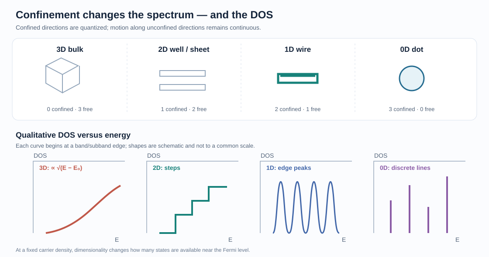
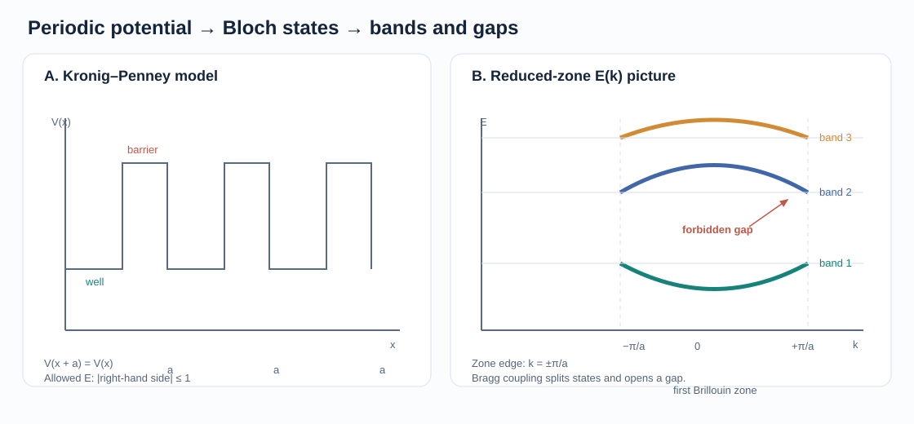
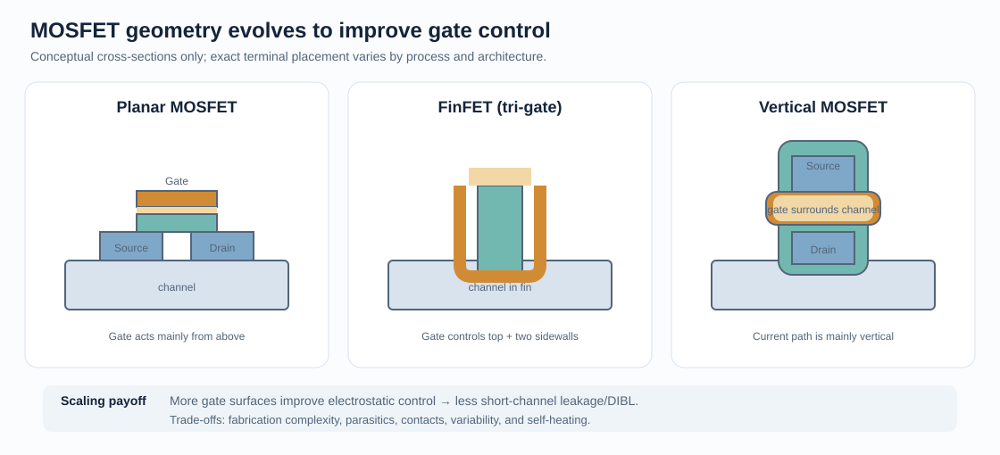
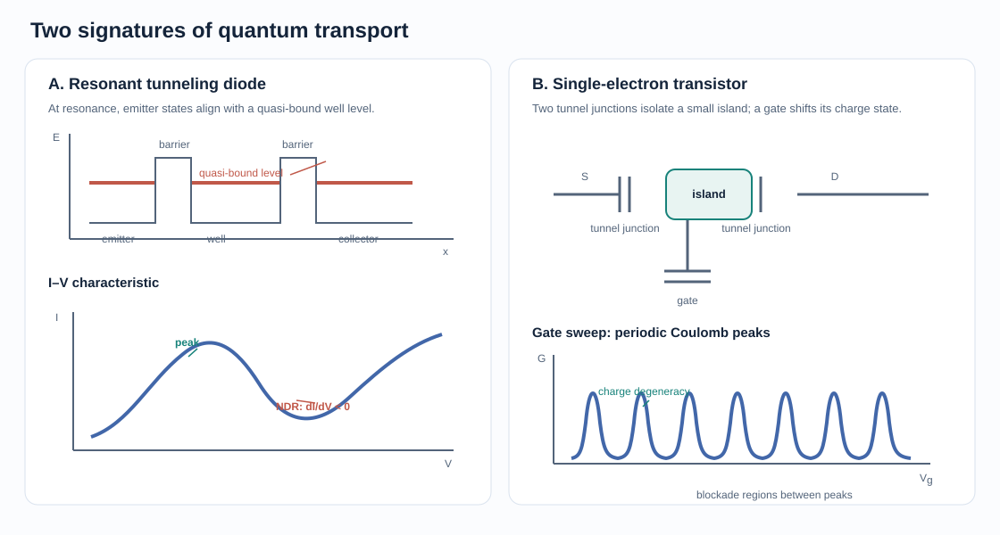
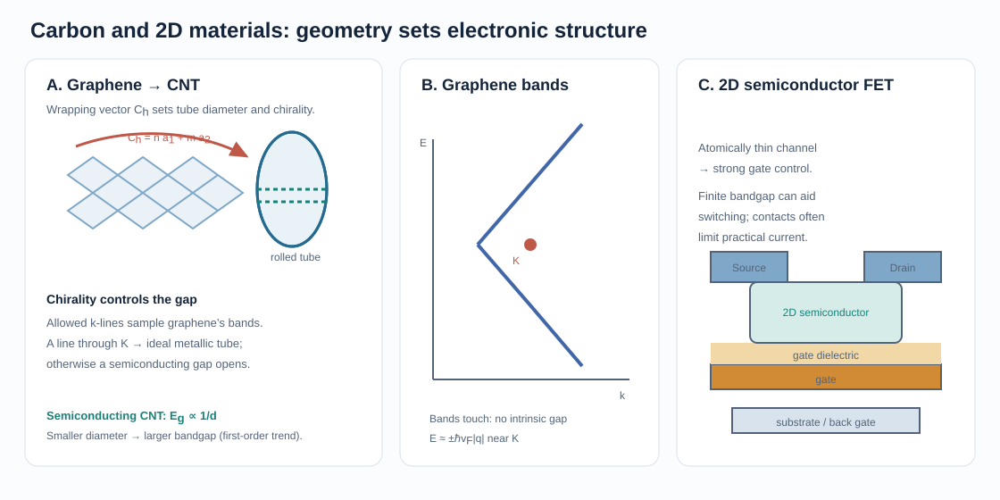
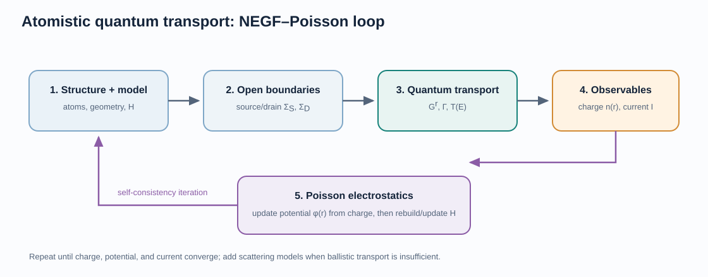

# Nanotechnology & Nanoelectronics — Exam-Focused Notes

These notes connect the listed topics into one chain:

> Shrinking a device makes its dimensions comparable to electron wavelengths and scattering lengths. Quantum confinement changes the energy spectrum and density of states; crystal periodicity creates bands; electrostatics and interconnects limit scaled CMOS; tunneling and charging produce new devices; atomistic models become necessary when continuum approximations stop being adequate.

**Notation:** \(q>0\) is the elementary charge, an electron has charge \(-q\), \(m_0\) is the free-electron mass, \(m^*\) is an effective mass, \(\hbar=h/(2\pi)\), \(k_B\) is Boltzmann’s constant, and \(E_C,E_V\) denote conduction- and valence-band edges. Unless noted, DOS is the number of states per energy and per appropriate spatial measure.

## 1. Introduction to nanotechnology and mesoscopic structures

### What “nano” means

Nanotechnology concerns structures and devices whose important dimensions are typically on the order of **1–100 nm**. This is a useful scale guide, not a sharp boundary. A material becomes interestingly nanoscale when reducing its dimensions changes its behavior—not merely its size.

Three effects explain much of that change:

1. **Large surface-to-volume ratio.** For a geometrically similar object, surface area scales as \(L^2\), volume as \(L^3\), so surface/volume scales as \(1/L\). Surface chemistry, interface traps, and surface scattering become increasingly important.
2. **Quantum confinement.** Confinement makes some components of the wavevector discrete. A rough confinement energy scale is
   \[
   \Delta E \sim \frac{\hbar^2\pi^2}{2m^*L^2}.
   \]
   Halving a confinement dimension increases this scale by about four.
3. **Finite-size and transport effects.** The device dimensions can become comparable to the electron de Broglie wavelength \(\lambda=2\pi/k\), the mean free path \(\ell\), or the phase-coherence length \(L_\phi\).

### Mesoscopic structures and transport regimes

“Mesoscopic” describes the crossover between microscopic quantum behavior and macroscopic classical transport. There is no single universal size range: the relevant comparison is between device dimensions and characteristic lengths.

- **Diffusive:** device length \(L\gg \ell\); many scattering events occur.
- **Ballistic:** \(L\lesssim \ell\); carriers cross with few momentum-relaxing collisions.
- **Phase coherent:** \(L\lesssim L_\phi\); the electron’s phase remains useful across the device.
- **Quantum confined:** at least one dimension is small enough that energy levels/subbands are resolved.

Ballistic and phase-coherent are related but **not synonyms**: momentum can be randomized without complete phase loss, and phase coherence can survive some elastic scattering.

### Dimensionality shorthand

| Structure | Confined dimensions | Free-motion dimensions | Typical example |
|---|---:|---:|---|
| 3D bulk | 0 | 3 | bulk crystal |
| 2D quantum well / sheet | 1 | 2 | inversion layer, monolayer |
| 1D wire | 2 | 1 | nanowire, nanotube |
| 0D quantum dot | 3 | 0 | island with discrete levels |

**Exam cue:** identify which dimensions are confined, then predict the energy spectrum and DOS shape. Confining one more dimension turns a continuum into subbands; confining all dimensions produces discrete levels.

## 2. Quantum-mechanics essentials

### Schrödinger equation

The time-dependent equation for a nonrelativistic particle in potential \(V(\mathbf r,t)\) is
\[
i\hbar\frac{\partial\Psi}{\partial t}
=\left[-\frac{\hbar^2}{2m}\nabla^2+V(\mathbf r,t)\right]\Psi.
\]
For a time-independent potential, separate variables as \(\Psi(\mathbf r,t)=\psi(\mathbf r)e^{-iEt/\hbar}\). The time-independent eigenvalue equation is
\[
\left[-\frac{\hbar^2}{2m}\nabla^2+V(\mathbf r)\right]\psi=E\psi.
\]
The quantity \(|\Psi|^2\) is probability density, so a normalized state obeys \(\int |\Psi|^2\,d^3r=1\). Boundary conditions are part of the physical model; they determine which energies are allowed.

### Infinite 1D potential well (“particle in a box”)

For \(V=0\) within \(0<x<L\), with infinitely high barriers outside, the wavefunction must vanish at both walls:
\[
\psi_n(x)=\sqrt{\frac{2}{L}}\sin\left(\frac{n\pi x}{L}\right),\qquad
E_n=\frac{n^2\pi^2\hbar^2}{2mL^2},\quad n=1,2,\ldots
\]

Key consequences:

- The ground-state energy is **not zero**. A zero-energy state would have zero momentum and could not satisfy both hard-wall boundary conditions.
- Level spacing is not uniform: \(E_{n+1}-E_n=(2n+1)\pi^2\hbar^2/(2mL^2)\).
- Confinement energy varies as \(1/L^2\), so nanoscale size changes can strongly shift levels.
- For a semiconductor nanostructure, replace \(m\) by the relevant band effective mass \(m^*\) in the effective-mass approximation.

For a 3D rectangular box,
\[
E_{n_xn_yn_z}=\frac{\pi^2\hbar^2}{2m}
\left(\frac{n_x^2}{L_x^2}+\frac{n_y^2}{L_y^2}+\frac{n_z^2}{L_z^2}\right).
\]

### Degeneracy

**Degeneracy** is the number of distinct states sharing one energy. In a cubic box of side \(L\),
\[
E\propto n_x^2+n_y^2+n_z^2.
\]
Permuting quantum numbers does not change the energy. For example, \((1,1,2)\), \((1,2,1)\), and \((2,1,1)\) form a threefold **spatial/orbital** degeneracy. If spin is unresolved, each orbital state can add a spin factor of two. Do not count spin twice if it is already included in a degeneracy factor.

Degeneracy depends on symmetry. Unequal box lengths, an electric or magnetic field, strain, or a non-symmetric confining potential can split levels that were degenerate in the ideal model.

### Density of states (DOS)

The DOS \(D(E)\) counts available states in an energy interval: \(D(E)dE\) is the number of states between \(E\) and \(E+dE\). It does **not** by itself give the number of occupied states; multiply by the Fermi–Dirac occupation \(f(E)=1/[1+\exp((E-E_F)/(k_BT))]\).

For a parabolic band with edge \(E_0\), define \(g=g_sg_v\) as the included spin and valley degeneracy. For one subband/valley of effective mass \(m^*\):

| Dimension | DOS per unit spatial measure | Energy dependence |
|---|---|---|
| 3D | \(\displaystyle D_{3D}(E)=\frac{g}{4\pi^2}\left(\frac{2m^*}{\hbar^2}\right)^{3/2}\sqrt{E-E_0}\,\Theta(E-E_0)\) per volume | rises as \(\sqrt{E-E_0}\) |
| 2D | \(\displaystyle D_{2D}(E)=\frac{g\,m^*}{2\pi\hbar^2}\sum_n\Theta(E-E_n)\) per area | constant within each subband; step at each edge |
| 1D | \(\displaystyle D_{1D}(E)=\frac{g}{2\pi}\sqrt{\frac{2m^*}{\hbar^2}}\sum_n\frac{\Theta(E-E_n)}{\sqrt{E-E_n}}\) per length | van Hove singularity at each subband edge |
| 0D | \(\displaystyle D_{0D}(E)=g\sum_n\delta(E-E_n)\) | discrete lines |

\(\Theta\) is the step function and \(\delta\) is the Dirac delta. These are ideal parabolic-band forms; disorder, temperature, finite lifetime, and nonparabolicity broaden or modify measured spectra.

**Useful derivation idea:** count allowed \(k\)-states in a circle/sphere (or interval) in reciprocal space, then differentiate the number of states \(N(E)\) with respect to energy. For a 2D parabolic band, \(E-E_0\propto k^2\), so the \(k\)-space area \(\propto k^2\propto E-E_0\), giving a constant DOS.

## 3. Band theory of solids

### From isolated atoms to bands

An isolated atom has discrete energy levels. When \(N\) atoms are brought together, overlap and the Pauli principle split each atomic level into roughly \(N\) closely spaced levels. In a large crystal these levels form **allowed bands**, separated by **forbidden gaps**.

- **Metal:** a band is partly occupied, or filled and overlapping another band, so nearby empty states are available.
- **Intrinsic semiconductor:** valence band full and conduction band empty at \(T=0\), separated by a moderate gap.
- **Insulator:** also has a filled valence band and empty conduction band, generally with a larger gap; the boundary is practical, not a strict fundamental distinction.

### Periodic lattice and Bloch waves

In a crystal \(V(\mathbf r+\mathbf R)=V(\mathbf r)\). Bloch’s theorem gives
\[
\psi_{n\mathbf k}(\mathbf r)=u_{n\mathbf k}(\mathbf r)e^{i\mathbf k\cdot\mathbf r},
\qquad u_{n\mathbf k}(\mathbf r+\mathbf R)=u_{n\mathbf k}(\mathbf r).
\]
The label \(n\) is the band index. Crystal wavevector \(\mathbf k\) is defined modulo a reciprocal-lattice vector \(\mathbf G\), so \(\mathbf k\) and \(\mathbf k+\mathbf G\) describe equivalent crystal momentum.

Near a parabolic band edge, curvature determines effective mass:
\[
\frac{1}{m^*}=\frac{1}{\hbar^2}\frac{d^2E}{dk^2}.
\]
Large curvature means small \(|m^*|\); small curvature means heavy carriers. Near a valence-band maximum, it is often more convenient to describe missing electrons as positively charged holes with positive effective mass.

### Kronig–Penney model

The Kronig–Penney model applies a simple periodic potential—often a sequence of rectangular barriers and wells—to the Schrödinger equation. It demonstrates how periodicity creates **allowed bands and forbidden gaps** without requiring a full atomic calculation.

For the delta-barrier comb \(V(x)=\lambda\sum_n\delta(x-na)\), one common dispersion relation is
\[
\cos(ka)=\cos(qa)+\frac{m\lambda}{\hbar^2q}\sin(qa),
\qquad q=\frac{\sqrt{2mE}}{\hbar}.
\]
The right-hand side must lie between \(-1\) and \(+1\), because the left-hand side is \(\cos(ka)\). Energies for which it lies in this range are allowed; where its magnitude exceeds 1, no real \(k\) exists and the energies form a gap.

For finite rectangular barriers, a different but analogous expression results. Always state which version/model a formula belongs to.

### Brillouin zones

The reciprocal lattice is the Fourier-space description of lattice periodicity. A **Brillouin zone (BZ)** is a Wigner–Seitz cell in reciprocal space. The first BZ contains one representative of each distinct crystal wavevector.

For a 1D lattice of period \(a\), reciprocal-lattice points are \(G=2\pi n/a\) and the first zone is
\[
-\frac{\pi}{a}\le k\le+\frac{\pi}{a}.
\]
At a zone boundary, counter-propagating waves can satisfy the Bragg condition and couple. The standing-wave combinations have different charge distributions relative to the ions, so their energies split and a band gap opens.

**Exam checklist:** define the lattice period; state Bloch form; distinguish real and reciprocal space; mark \(\pm\pi/a\); explain that a gap is an energy interval with no propagating Bloch state in the ideal periodic model.

## 4. Shrink-down approaches and CMOS scaling

### Why scale CMOS?

Reducing transistor dimensions historically increased transistor density and switching speed while lowering switching energy per device. **Geometric scaling alone is not enough**: gate length, width, oxide/equivalent oxide thickness, junction depth, depletion dimensions, supply voltage, and doping must be co-designed.

### Ideal constant-field (Dennard) scaling

Let each linear dimension scale by \(1/\kappa\) with \(\kappa>1\). In ideal constant-field scaling, voltage also scales by \(1/\kappa\), and doping scales by \(\kappa\). A useful exam table is:

| Quantity | Ideal scaling |
|---|---:|
| Length, width, oxide thickness | \(1/\kappa\) |
| Voltage, threshold voltage | \(1/\kappa\) |
| Electric field | constant |
| Gate capacitance per transistor | \(1/\kappa\) |
| Current per transistor | \(1/\kappa\) |
| Intrinsic delay | \(1/\kappa\) |
| Switching energy \(CV^2\) | \(1/\kappa^3\) |
| Transistor density | \(\kappa^2\) |
| Power per transistor | \(1/\kappa^2\) |
| Power per area (ideal) | approximately constant |

Modern scaling is **not** ideal constant-field scaling. Supply voltage cannot keep dropping freely, leakage becomes important, and wire delay, variability, heat removal, and fabrication constraints become dominant.

## 5. The nanoscale MOSFET

A MOSFET uses the gate electric field to control a source-to-drain channel. As gate length \(L_g\) shrinks, the source/drain fields increasingly influence the channel barrier. The gate loses exclusive control of the channel.

### Main short-channel and nanoscale effects

- **Drain-induced barrier lowering (DIBL):** increasing drain voltage lowers the source-side channel barrier, increasing off-state current and often lowering apparent threshold voltage.
- **Threshold roll-off:** threshold voltage changes with channel length because source/drain depletion regions occupy a larger fraction of the channel.
- **Subthreshold leakage:** current flows below threshold; ideal thermionic MOSFET subthreshold swing is limited by \(S\ge (k_BT/q)\ln 10\), about \(60\ \text{mV/decade}\) at 300 K.
- **Gate leakage:** very thin SiO\(_2\) permits direct tunneling. High-\(k\) dielectrics allow a physically thicker dielectric for similar gate capacitance.
- **Velocity saturation / mobility degradation:** high lateral and vertical fields reduce the usefulness of the long-channel square-law model.
- **Quantum confinement:** thin body dimensions shift subband energies and alter charge distribution/capacitance.
- **Source-to-drain tunneling:** when the barrier is short and thin, carriers can tunnel through even when the transistor is “off.”
- **Variability:** line-edge roughness, discrete dopants, interface traps, and work-function granularity cause larger device-to-device differences.

Long-channel equations are useful for intuition, but a nanoscale MOSFET is not just a scaled square-law transistor. At very short lengths, source injection, quantum transport, contact resistance, and electrostatics require more complete models.

### FinFETs

A FinFET raises a thin semiconductor **fin** above the substrate. The gate covers the fin’s two sidewalls and top (a tri-gate geometry), so the channel is controlled from multiple sides. This improves electrostatic control and suppresses short-channel effects compared with a planar gate acting from one side.

The effective channel width is approximately
\[
W_{\text{eff}}\approx N_{\text{fin}}(2H_{\text{fin}}+W_{\text{fin}})
\]
for \(N_{\text{fin}}\) similar fins, ignoring detailed corner and layout corrections. Drive current can be increased by using more fins or taller fins, subject to process and parasitic constraints.

**Advantages:** stronger gate control, reduced DIBL/threshold roll-off, good drive per footprint.

**Costs/challenges:** fin-width/height variability, quantized layout width, more demanding patterning/etching, parasitic capacitance and resistance, self-heating, and harder contact integration.

### Vertical MOSFETs

In a vertical MOSFET, the channel runs mainly **up/down** through a fin or pillar rather than laterally across a planar surface. The gate wraps around or surrounds the vertical channel. The vertical geometry can decouple channel length from the planar footprint and can support dense stacking/integration.

The exact architecture varies: “vertical MOSFET” is a family, not one unique cross-section. Be clear in an exam sketch about where source, channel, drain, and gate are located. Typical challenges include difficult vertical process control, contact resistance, thermal paths, parasitics, and variability.

### Scaling and system-integration limits

At the system level, the transistor is only part of the delay and power budget.

- **Interconnect RC:** for a wire, \(R\approx\rho L/(wt)\). A distributed line has delay on the order of \(r c L^2\), where \(r,c\) are resistance and capacitance per length. As wires narrow, resistance rises; coupling and substrate capacitance remain significant.
- **Crosstalk:** switching on one wire capacitively induces a disturbance on a nearby wire.
- **IR drop and electromigration:** high current density through narrow conductors causes voltage loss and can damage interconnects.
- **Thermal limits:** power density and poor heat removal constrain frequency and stacking.
- **Contact resistance:** a shrinking contact can dominate total device resistance.
- **System integration:** 3D stacking/chiplets shorten some links and improve integration, but introduce thermal, yield, bonding, and test challenges.

**Exam distinction:** transistor scaling improves intrinsic device metrics; it does not guarantee whole-chip performance scaling because wires, power delivery, heat, and integration scale differently.

## 6. Resonant tunneling diode (RTD)

An RTD is typically a **double-barrier quantum heterostructure**. A quantum well between two barriers supports quasi-bound states. When an emitter state aligns with a quasi-bound state, transmission rises sharply and current reaches a peak.

1. At low bias, the occupied emitter states may not align with a well state: current is small.
2. As bias increases, alignment occurs: resonant tunneling produces a current peak.
3. Further bias shifts the energy windows out of alignment: current falls even though voltage rises.
4. At still higher bias, other states/transport channels raise current again.

The falling segment has **negative differential resistance (NDR)**:
\[
\frac{dI}{dV}<0.
\]
This is not negative current; it is a region where incremental current decreases as voltage increases.

**Uses:** high-frequency oscillators, switching, and compact multi-valued/logic concepts. **Limitations:** small current/voltage margins, sensitivity to layer thickness and temperature, parasitic effects, and integration/material challenges.

## 7. Coulomb dots, charging energy, and quantum blockade

A **quantum dot** confines carriers in all three spatial dimensions. It can show both:

- **Quantum confinement:** discrete orbital energies.
- **Coulomb charging:** adding charge costs electrostatic energy.

For an island with total capacitance \(C_\Sigma\), the electrostatic energy of charge \(Q\) is
\[
E(Q)=\frac{Q^2}{2C_\Sigma}.
\]
The conventional single-electron charging energy is
\[
E_C=\frac{q^2}{2C_\Sigma}.
\]
The energy difference between adjacent charge states depends on gate-induced charge and background offset. In the constant-interaction model,
\[
E(N)=\frac{(Nq-Q_g)^2}{2C_\Sigma},\qquad Q_g=C_gV_g+Q_{\text{offset}}.
\]
At **charge degeneracy**, two neighboring charge states have equal energy and tunneling is allowed at very small bias. Between degeneracy points, adding/removing an electron costs energy, suppressing current: this is **Coulomb blockade**.

For clearly resolved blockade, roughly require \(E_C\gg k_BT\) and tunnel-junction resistance large compared with the resistance quantum \(h/q^2\approx25.8\ \text{k}\Omega\) (conventions and device details matter). The thermal condition explains why very small dots and/or low temperature are needed.

**Do not conflate:**

- Quantum-level spacing \(\Delta E_{\text{level}}\): set mainly by confinement geometry and effective mass.
- Charging energy \(E_C\): set mainly by island capacitance.

They can both matter in a small dot; the observable addition energy can include both.

## 8. Single-electron transistor (SET)

An SET has a small conducting island between source and drain through two tunnel junctions. A gate couples capacitively to the island and shifts its electrochemical potential.

**Operation**

1. At a gate voltage between charge-degeneracy points, the island’s charge is stable and sequential tunneling is blocked.
2. Sweeping gate voltage moves an island addition level into the source/drain bias window.
3. One electron can tunnel onto the island and then off it; current flows.
4. Repeating the sweep gives periodic **Coulomb oscillations** in conductance/current.

In a plot of differential conductance versus gate voltage and source-drain bias, blockade regions form **Coulomb diamonds**. Diamond height relates to charging/addition energy; gate-voltage period is approximately \(q/C_g\) in the simple constant-interaction model.

**Advantages:** exceptional charge sensitivity, very low switching energy in principle, and useful charge sensing.

**Challenges:** small thermal energy margin, background-charge sensitivity, tunnel-barrier/process variation, low output current, and difficult room-temperature operation unless the island is extremely small and well controlled.

## 9. Carbon nanotube electronics

A single-wall carbon nanotube (SWCNT) is a graphene sheet rolled into a cylinder. Its wrapping or **chiral vector** is
\[
\mathbf C_h=n\mathbf a_1+m\mathbf a_2,
\]
where \((n,m)\) determines diameter and chirality. With graphene lattice constant \(a=\sqrt{3}a_{CC}\approx0.246\ \text{nm}\),
\[
d=\frac{|\mathbf C_h|}{\pi}
=\frac{a}{\pi}\sqrt{n^2+nm+m^2}.
\]
Rolling imposes periodic boundary conditions around the circumference, allowing only specific transverse wavevectors. If an allowed line passes through a graphene \(K\) point, the ideal tube is metallic; otherwise it is semiconducting. In the common convention, \((n-m)\bmod 3=0\) gives metallic tubes (with small curvature-induced gaps possible except for ideal armchair tubes); other families are semiconducting.

For a semiconducting tube, a useful first-order bandgap estimate is
\[
E_g\approx\frac{2a_{CC}\gamma_0}{d},
\]
where \(a_{CC}\) is the carbon-carbon bond length and \(\gamma_0\) is a nearest-neighbor hopping energy. The important exam result is the inverse-diameter trend: **smaller tube → larger gap**.

### Bands, DOS, and transport

- CNTs are quasi-1D, so their DOS has sharp van Hove features at subband edges.
- Semiconducting CNTs can form a gate-controlled channel; metallic CNTs can act as conductors but can cause off-state leakage if mixed into a transistor array.
- Near a band edge, subbands can be approximated as parabolic; near graphene’s \(K/K'\) points, the dispersion is approximately linear.
- Long mean free paths and strong gate coupling are attractive, but real performance depends strongly on contacts, defects, tube diameter/chirality, electrostatics, and inter-tube variation.

**Applications:** high-performance/low-power FET research, flexible electronics, chemical/biological sensors, interconnect research, and field emitters.

## 10. Graphene and 2D semiconductor devices

### Graphene

Graphene is a single atomic layer of carbon in a honeycomb lattice. Near the \(K\) and \(K'\) points, conduction and valence bands meet in approximately linear **Dirac cones**:
\[
E(\mathbf q)\approx \pm\hbar v_F|\mathbf q|.
\]
This yields high carrier mobility in clean devices and ambipolar field-effect behavior: gate voltage can tune carriers from electron-like to hole-like.

The major digital-logic limitation is that ideal monolayer graphene has **no bandgap**. A small gap is difficult to introduce without degrading transport. Graphene nanoribbons, bilayer graphene under a perpendicular displacement field, and heterostructure engineering can open/tune gaps, but each introduces tradeoffs.

### 2D semiconductors

Transition-metal dichalcogenides (TMDs), such as MoS\(_2\), WS\(_2\), and WSe\(_2\), are layered materials whose monolayers can be semiconducting. Some common TMDs have a direct optical gap in the monolayer limit and an indirect gap in thicker bulk form; this is **material-dependent**, not a rule for every 2D crystal.

Potential device advantages:

- atomically thin body gives strong electrostatic gate control;
- finite bandgap supports a high on/off ratio unlike gapless graphene;
- van der Waals stacking enables heterogeneous 2D interfaces without conventional lattice matching.

Challenges include contact resistance/Schottky barriers, defects and grain boundaries, environmental sensitivity, dielectric-interface traps, variability, and heat extraction. Graphene is often attractive for fast transport/interconnect/sensing; semiconducting 2D materials are more promising for switching when a bandgap is required.

## 11. Atomistic simulation

When a channel contains only a few atomic planes or transport is strongly quantum mechanical, continuum drift-diffusion models may miss important physics. Atomistic simulation represents the crystal structure and electronic states at atomic resolution.

### Common levels of description

| Method | Main idea | Strength | Typical limitation |
|---|---|---|---|
| Effective-mass / \(k\cdot p\) | Continuum envelope functions near band extrema | Efficient; good near calibrated band edges | Misses atomistic detail and some valleys/interfaces |
| Empirical tight binding | Localized atomic orbitals with fitted onsite/hopping terms | Captures atomistic geometry and bands at moderate cost | Accuracy depends on parameterization |
| Density-functional theory (DFT) | First-principles electronic structure | Strong material/chemistry basis | High computational cost; standard approximations can misestimate gaps |
| NEGF transport | Open-system quantum transport using Green’s functions | Handles contacts and coherent transport | Computationally intensive; scattering models add complexity |

### NEGF–Poisson workflow

1. Build atomic/device geometry and choose a Hamiltonian \(H\).
2. Attach source/drain contacts, represented by self-energies \(\Sigma_S,\Sigma_D\).
3. Compute retarded Green’s function:
   \[
   G^r(E)=\left[E I-H-\Sigma_S(E)-\Sigma_D(E)\right]^{-1}.
   \]
4. Obtain transmission:
   \[
   T(E)=\mathrm{Tr}\!\left[\Gamma_SG^r\Gamma_DG^a\right],\qquad
   \Gamma_{S,D}=i(\Sigma_{S,D}-\Sigma_{S,D}^\dagger).
   \]
5. Find carrier density and current. For a spin-degenerate coherent channel,
   \[
   I=\frac{2q}{h}\int T(E)\,[f_S(E)-f_D(E)]\,dE.
   \]
6. Update electrostatic potential by solving Poisson’s equation with the quantum charge density, rebuild/update \(H\), and iterate until self-consistent.

**Exam distinction:** Schrödinger’s equation gives states for a closed/confining system; NEGF treats an open device attached to reservoirs. The Landauer formula emphasizes transmission; NEGF provides a systematic way to calculate it and the nonequilibrium charge.

## 12. High-yield comparison tables

### Quantum well, wire, and dot

| Feature | Quantum well (2D) | Quantum wire (1D) | Quantum dot (0D) |
|---|---|---|---|
| Confined directions | 1 | 2 | 3 |
| Free directions | 2 | 1 | 0 |
| Spectrum | subbands | subbands | discrete levels |
| DOS | step-like | edge singularities | delta-like peaks |
| Typical example | thin inversion layer | nanowire/CNT | gated island |

### Planar MOSFET vs FinFET vs vertical MOSFET

| Property | Planar | FinFET | Vertical MOSFET |
|---|---|---|---|
| Gate control | one main surface | several fin surfaces | wraps/surrounds vertical channel (architecture-dependent) |
| Main scaling benefit | simple, mature planar geometry | stronger channel control | channel length can be less tied to planar footprint |
| Main cost | SCE at short \(L_g\) | fin patterning/variability/parasitics | complex vertical processing, contacts, thermal path |

### Device mechanism

| Device | Key physical effect | “Control knob” | Signature |
|---|---|---|---|
| RTD | resonant transmission through double barrier | bias shifts alignment | peak then NDR in \(I\)-\(V\) |
| Quantum dot | confinement + charging | geometry, gate, bias | discrete levels / addition energy |
| SET | single-electron tunneling with Coulomb blockade | gate voltage | Coulomb oscillations / diamonds |
| CNT-FET | gate-controlled 1D subbands | gate bias, chirality, contacts | semiconducting tube channel |
| Graphene FET | ambipolar transport in gapless 2D bands | gate bias | Dirac point; modest off-state without gap |
| 2D TMD FET | gate-controlled semiconducting monolayer | gate bias, contact engineering | finite-gap switching, contact-limited behavior possible |

## 13. Common exam mistakes to avoid

1. Calling DOS the number of **occupied** states. Occupancy additionally requires \(f(E)\).
2. Setting the particle-in-a-box ground-state energy to zero.
3. Confusing orbital degeneracy with spin degeneracy.
4. Saying that every nanoscale structure is automatically quantum confined; compare dimensions with wavelength/energy scales.
5. Saying all \(k\)-values are distinct. Crystal wavevectors differing by a reciprocal vector are equivalent.
6. Saying the Kronig–Penney model predicts every real band exactly. It is a pedagogical periodic-potential model.
7. Drawing an RTD NDR region as negative current; it means \(dI/dV<0\).
8. Confusing Coulomb blockade with a bandgap. One is a charging-energy effect; the other is a forbidden band-energy interval.
9. Assuming graphene is a good conventional digital switch simply because its mobility can be high; the absent intrinsic bandgap is the key issue.
10. Treating FinFETs/vertical FETs as only “smaller transistors.” Their main purpose is improved electrostatic control and/or geometry/integration.
11. Claiming transistor scaling alone solves system performance; wire RC, power delivery, contacts, and heat matter.

## 14. Rapid-revision formula sheet

\[
\begin{aligned}
&\text{Time-independent Schrödinger:} &&
\left[-\frac{\hbar^2}{2m}\nabla^2+V\right]\psi=E\psi\\
&\text{1D infinite well:} &&
E_n=\frac{n^2\pi^2\hbar^2}{2mL^2},\quad
\psi_n=\sqrt{\frac{2}{L}}\sin\frac{n\pi x}{L}\\
&\text{Bloch form:} &&
\psi_{n\mathbf k}=u_{n\mathbf k}e^{i\mathbf k\cdot\mathbf r}\\
&\text{1D first BZ:} &&
-\pi/a\le k\le\pi/a\\
&\text{Effective mass:} &&
\left(m^*\right)^{-1}=\hbar^{-2}\,d^2E/dk^2\\
&\text{Charging energy:} &&
E_C=q^2/(2C_\Sigma)\\
&\text{Landauer current:} &&
I=(2q/h)\int T(E)[f_S-f_D]\,dE\\
&\text{CNT diameter:} &&
d=(a/\pi)\sqrt{n^2+nm+m^2}\\
&\text{CNT gap trend:} &&
E_g\propto1/d\\
&\text{Ideal MOS subthreshold swing:} &&
S\ge(k_BT/q)\ln10
\end{aligned}
\]

## 15. Likely long-answer questions

Use these as timed practice. For a 10-mark answer, include a labeled diagram, assumptions, governing equation, physical explanation, and one limitation/application.

1. **Derive the energy eigenvalues of an electron in a 1D infinite potential well.** Explain why the ground-state energy is nonzero and how energy changes with well width.
2. **Explain dimensionality-dependent DOS.** Sketch 3D, 2D, 1D, and 0D DOS and state how confinement creates subbands/levels.
3. **Explain band formation and the origin of band gaps using the Kronig–Penney model.** Include Bloch’s theorem, the allowed-energy condition, and a first-BZ sketch.
4. **State ideal constant-field CMOS scaling laws and discuss why real scaling departs from them.** Include short-channel effects and interconnect/thermal limits.
5. **Compare planar MOSFET, FinFET, and vertical MOSFET geometries.** Explain the electrostatic advantage and implementation tradeoff of each.
6. **Explain the operation of an RTD and draw its NDR characteristic.** Relate the current peak and valley to the alignment of a quasi-bound state.
7. **Explain Coulomb blockade and the SET.** Define \(C_\Sigma\), \(E_C\), gate-induced charge, the thermal/resistance conditions, and Coulomb oscillations or diamonds.
8. **Explain how chirality determines CNT electronic character.** Draw graphene zone folding and discuss metallic/semiconducting tubes, DOS, and device applications.
9. **Compare graphene and a semiconducting 2D material for logic FETs.** Cover bandgap, transport, electrostatics, contacts, and practical limitations.
10. **Outline an atomistic NEGF–Poisson simulation.** Explain the Hamiltonian, self-energies, transmission, current, self-consistency, and one model limitation.

## Sources for further study

These open course materials informed the scope and provide additional derivations and worked examples:

- [MIT OCW — Introduction to Nanoelectronics, particle in a box and DOS](https://ocw.mit.edu/courses/6-701-introduction-to-nanoelectronics-spring-2010/87bcb751ac255175479bc19f97ecb2ad_MIT6_701S10_part2.pdf)
- [MIT OCW — Introduction to Nanoelectronics, electronic structure of materials and carbon nanotubes](https://ocw.mit.edu/courses/6-701-introduction-to-nanoelectronics-spring-2010/2629cb709eaff5bba4ef033af638f68d_MIT6_701S10_part6.pdf)
- [NPTEL — Electronic Structure of Materials: reciprocal lattice, Brillouin zones, Bloch electrons, and Kronig–Penney model](https://nptel.ac.in/courses/113104012)
- [MIT OCW — MOSFET scaling lecture notes](https://ocw.mit.edu/courses/6-720j-integrated-microelectronic-devices-spring-2007/resources/lecture32/)
- [NPTEL — Nanoelectronics and CMOS scaling, short-channel effects, and FinFET topics](https://nptel.ac.in/courses/117108047)
- [NPTEL — RTD double-barrier and resonant tunneling notes](https://archive.nptel.ac.in/content/storage2/courses/115101007/modules/P2M5/lec4/1.5.html)
- [NPTEL — Coulomb blockade and SET equivalent circuit](https://archive.nptel.ac.in/content/storage2/courses/115101007/modules/P2M8/lec1/1.8.html)
- [Purdue ECE — Introduction to Quantum Transport course outline](https://engineering.purdue.edu/ECE/Academics/Undergraduates/UGO/CourseInfo/courseInfo?courseid=719&show=true&type=undergrad)
- [MIT OCW — Atomistic computer modeling of materials](https://ocw.mit.edu/courses/3-320-atomistic-computer-modeling-of-materials-sma-5107-spring-2005/resources/4_21_1/)

